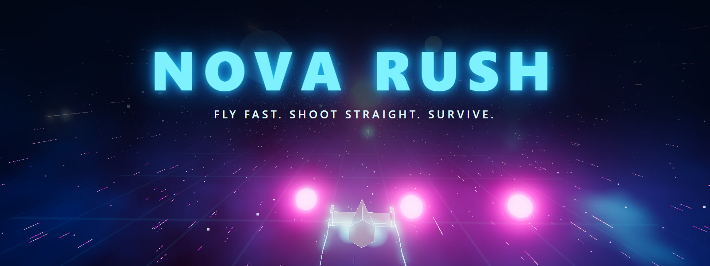
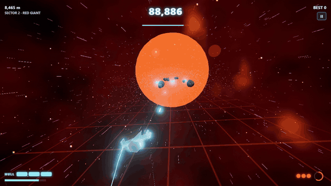
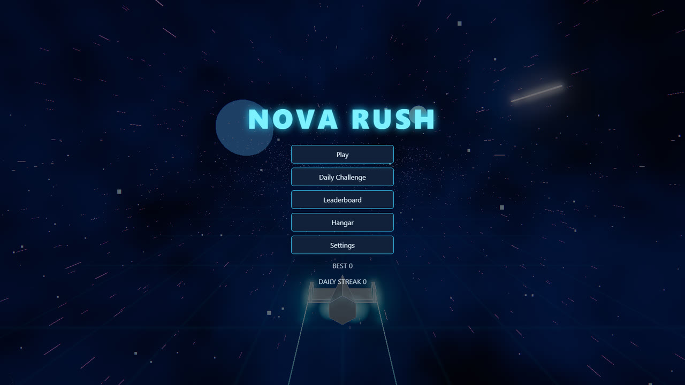
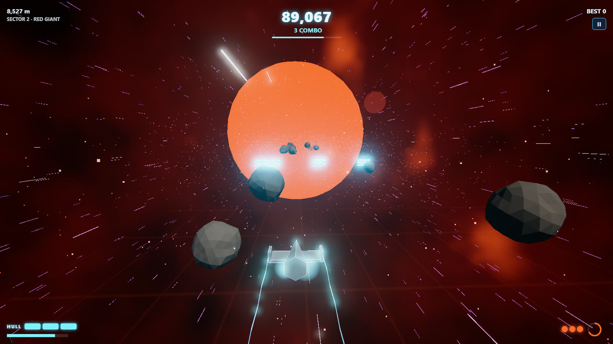
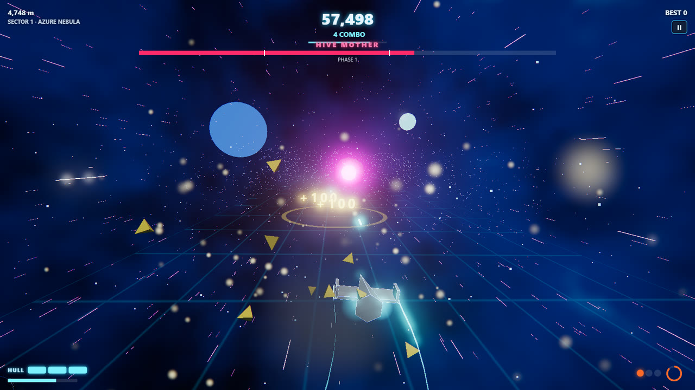
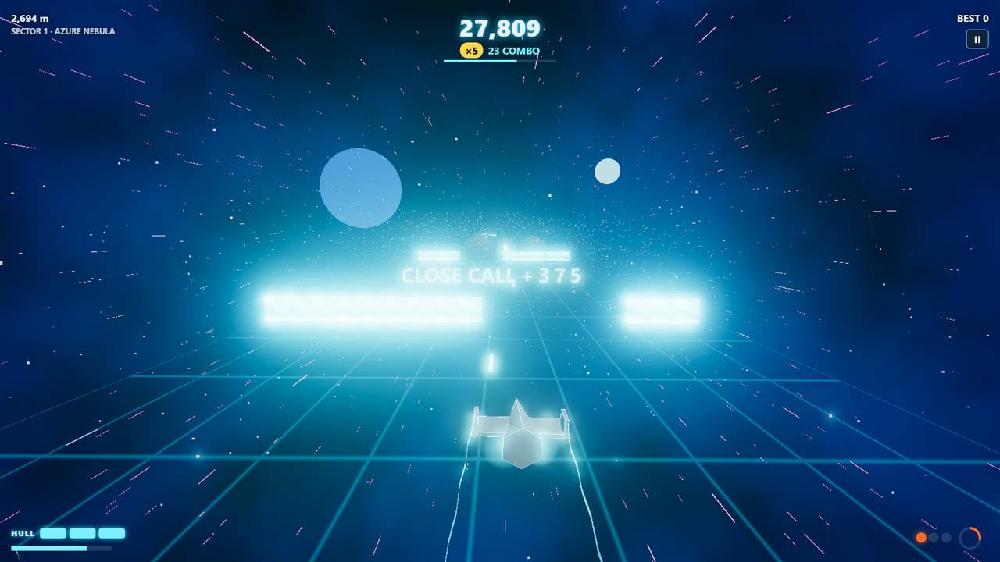
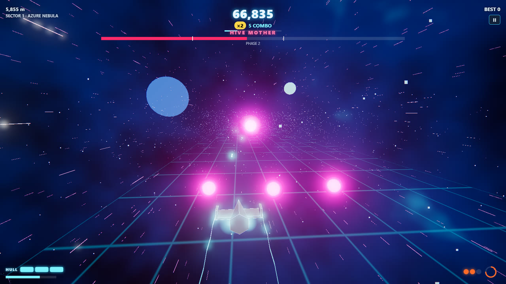
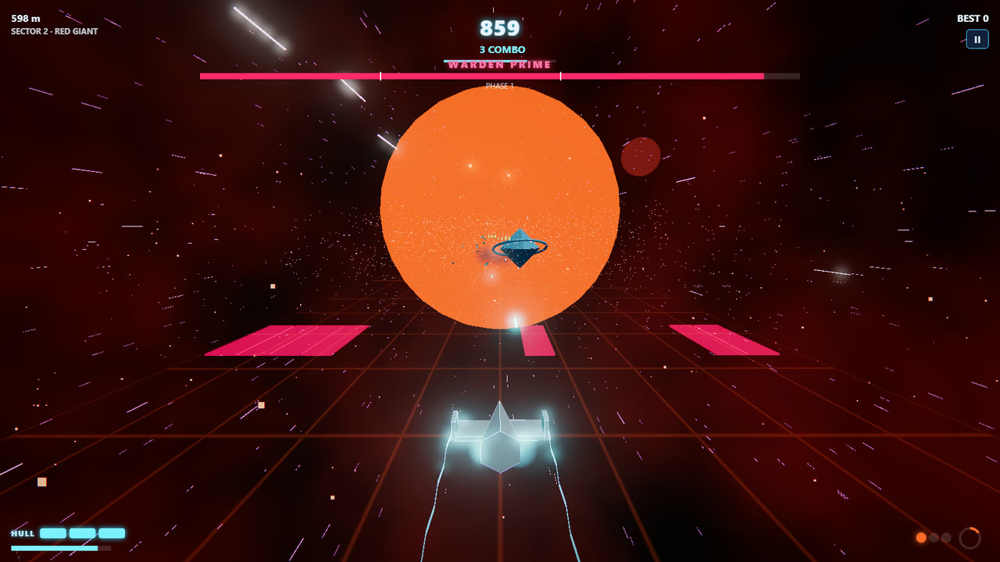
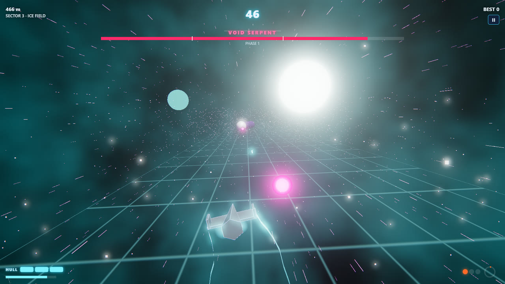

<p align="center">
  
</p>

<p align="center">
  <a href="https://github.com/MAcemek/nova-rush/actions/workflows/ci.yml"></a>
  <a href="LICENSE"></a>
  
  
</p>

Nova Rush is a 3D arcade shooter that runs in the browser. Fly down an endless space corridor that keeps getting faster, blast asteroids and aliens, chain combos, and take on three bosses.

All of the visuals and audio are generated in code, so there are no model, texture or sound files to download.

<p align="center">
  
</p>

## Features

- **Five sectors**: Azure Nebula, Red Giant, Ice Field, Alien Hive and The Void.
- **Three boss fights**: Hive Mother, Warden Prime and Void Serpent, each with multiple phases.
- **Power-ups**: Spread, Rapid, Pierce, Magnet, double score, Shield, Jump, Battering Ram, Repair and Overhaul.
- **Combos and near misses**: keep the chain alive and fly close to danger for extra points.
- **Daily challenge**: everyone gets the same seed each UTC day, with crystal rewards and streaks.
- **Hangar**: spend crystals on hulls, paints, lasers and trails.
- **Verified leaderboard**: the server replays each submitted run before accepting its score.
- **Synthesized audio**: sound effects and adaptive music made with Web Audio.

## Screenshots

| | |
|:---:|:---:|
|  |  |
| Title screen | Red Giant |
|  |  |
| Scoring kills | Threading the barriers |
|  |  |
| Boss: Hive Mother | Boss: Warden Prime |

<p align="center">
  <br>
  Boss: Void Serpent
</p>

## Quick start

Requires Node 24 or newer.

```
git clone https://github.com/MAcemek/nova-rush.git
cd nova-rush
npm install
npm run dev
```

Open http://localhost:5173. The leaderboard API runs on port 8790.

To build for production and serve everything from one server at http://localhost:8790:

```
npm run start
```

## Controls

| Action | Keyboard | Touch |
|---|---|---|
| Steer | A / D or Left / Right | Drag on the left half of the screen |
| Fire | Space (auto-fire is on by default) | Automatic |
| Nuke | N or right-click (rebindable) | NUKE button |
| Barrel roll | Q / E or double-tap A / D | ROLL button |
| Jump (needs the power-up) | W or Up | JUMP button |
| Pause | Esc | Pause button |

For mouse steering, set Steering to Mouse in Settings.

## How it works

| Path | Purpose |
|---|---|
| `src/core/` | Deterministic 60 Hz simulation, shared by the client and the server |
| `src/render/` | three.js rendering, particles, post-processing and adaptive quality |
| `src/audio/` | Synthesized sound effects and adaptive music |
| `src/ui/` | HUD, menus, touch controls and other screens |
| `src/meta/` | Profile, missions, achievements and cosmetics, stored in localStorage |
| `server/` | Express and `node:sqlite` leaderboard API with replay verification |

### Replay verification

1. The client records the input for every tick of a run.
2. It submits that recording with the score, distance and a hash of the final game state.
3. The server replays the inputs through the same `src/core/` code.
4. The run is rejected unless the score, distance and hash all match exactly.

Submissions are rate limited, and daily runs are accepted only for today's or yesterday's seed. Replaying proves that the inputs produce the score. It does not prove that a person played them.

## Development

| Command | What it does |
|---|---|
| `npm run dev` | Starts the client and API with live reload |
| `npm test` | Runs the test suite |
| `npm run typecheck` | Checks types |
| `npm run build` | Checks types and builds the client |
| `npm run fuzz -- --runs 500` | Plays randomized runs and checks simulation invariants |
| `npm run bot -- --runs 200` | Prints balance statistics from autopilot runs |

Add these to the URL for testing:

| Parameter | Effect |
|---|---|
| `?autopilot=1` | The bot plays |
| `?god=1` | The ship takes no damage |
| `?boss=hive`, `warden` or `serpent` | Starts in that boss fight |
| `?seed=N` | Uses a fixed seed |
| `?debug=1` | Shows the debug panel |
| `?selftest=quick` or `full` | Runs the in-browser self-test |

See [CONTRIBUTING.md](CONTRIBUTING.md) before opening a pull request.

## License

[MIT](LICENSE)
